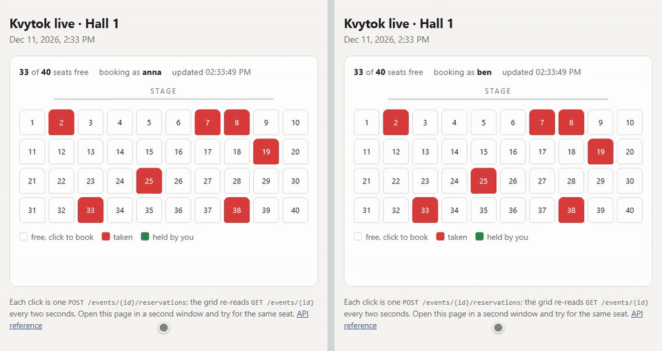
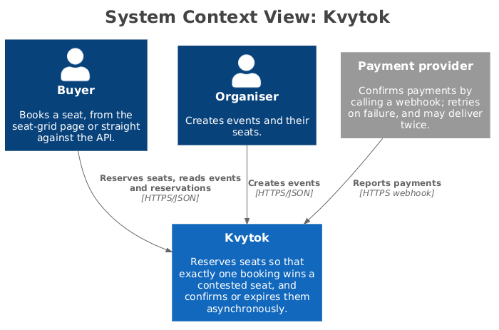
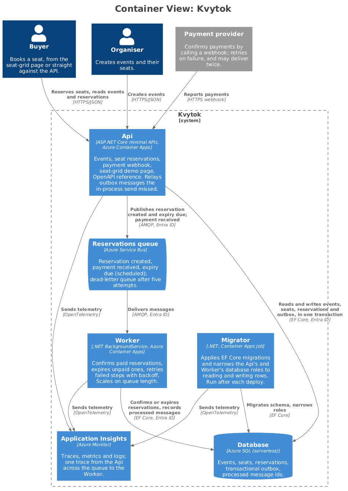

# Kvytok

[](https://github.com/iFedaka/Kvytok/actions/workflows/ci.yml?query=branch%3Amain)

Seat reservation for events with a fixed number of seats. A study in what happens when
hundreds of requests compete for the same seat, and in how such a service is operated on
Azure. A portfolio project, not a product.

**Try it:** [seat grid](https://api.agreeablebay-afb9f153.swedencentral.azurecontainerapps.io/demo/) ·
[API reference](https://api.agreeablebay-afb9f153.swedencentral.azurecontainerapps.io/scalar) ·
[live API](https://api.agreeablebay-afb9f153.swedencentral.azurecontainerapps.io/).
It scales to zero, so the first request after idle can take over a minute.

## Why

An event has 200 seats. Hundreds of people press "book" on the same seat in the same
second. An unpaid reservation expires after 10 minutes and the seat goes back to the pool.
Payment confirmations arrive asynchronously, out of order, and sometimes twice. Three things
must hold:

- exactly one booking wins a contested seat; the losers get a clear `409`;
- a message delivered twice takes effect once;
- if the worker dies mid-processing, nothing is lost and nothing is double-charged.



## How it works

<!-- c4:context:start -->

<!-- c4:context:end -->

<!-- c4:containers:start -->

<!-- c4:containers:end -->

The Api and the Worker never call each other; they meet at the queue and the database.

- **Api** (ASP.NET Core, vertical slices). A contested seat is decided by one conditional
  update, `SET Status = 'Held' WHERE Status = 'Free'`: SQL Server locks the row, one request
  changes it, the rest get `409`. A filtered unique index (one active reservation per seat)
  backs that up in the database itself. Before the update, a plain read of the seat's status
  turns away requests for a seat already taken; under read committed snapshot it takes no lock,
  so most of a burst never queues for the row. Reserving writes two outbox rows (created and
  expiry) in the same transaction; they are published right after the commit, and a timer drains
  whatever that missed.
  A payment arrives as a webhook that only puts a message on the queue.
- **Worker** (Container Apps, scaled by KEDA on queue length). Confirms paid reservations and
  expires unpaid ones. Both are writes conditional on the reservation's `rowversion`, so a
  payment racing an expiry has one winner. Each message id is recorded in the transaction of
  the step it caused, so a duplicate is skipped. Failures retry with backoff, then dead-letter.
- **Data and messaging.** Azure SQL (serverless) and Service Bus, reached through managed
  identities: no connection secrets anywhere.
- **Observability.** Application Insights with one trace from the Api across the queue to the
  Worker, and a dashboard kept in Bicep. See [observability](docs/observability.md).

The diagrams are generated from [workspace.dsl](docs/architecture/workspace.dsl) by
`./scripts/sync-architecture.ps1` (needs Docker); CI fails if they are stale.
The reasoning behind the choices (Service Bus over Storage Queues, an in-process HybridCache
instead of Redis, Container Apps over AKS, and more) is in [docs/decisions.md](docs/decisions.md)
and the [ADRs](docs/adr).

## Run it locally

You need the .NET 10 SDK, Docker, and `az login` (Service Bus and Application Insights have no
local stand-in, so Aspire provisions them in a resource group in your subscription; it asks
for the subscription on the first run).

```
dotnet run --project src/Kvytok.AppHost
```

SQL Server starts in a container. The Aspire dashboard lists every resource and its traces;
the seat grid is at `/demo/` on the Api. Tests (`dotnet test`) run against a real SQL Server
through Testcontainers.

## Deploy to Azure

```
azd auth login
azd up
```

About 6 minutes: roughly 5 to provision the Bicep in `infra/`, under 1 to deploy the Api and
Worker and run the migrations job. `azd down` removes everything. The runbook runs `azd provision`
and `azd deploy` separately, because packaging overlapping provisioning failed once; `azd up` is
both in one go. Cost: the Container Registry is the one charge at rest, about $5 a month; Container
Apps compute has been free since the Worker started scaling to zero. Invoice figures, failure modes and teardown are in the [runbook](docs/deploy.md).

## Load test

[k6](tests/load/hot-seat.js) against the deployed environment, from a laptop: every virtual
user waits for the same instant, then reserves seat 1 of a fresh event. Run it with
`tests/load/run.sh`.

| Contenders | Result | Losing request p95 |
| --- | --- | --- |
| 200 | 1 × `201`, 199 × `409` | 181 ms (3 replicas) |
| 400 | 1 × `201`, 399 × `409` | 790 ms |
| 800 | 1 × `201`, 799 × `409` | 1053 ms |

- **Correct every time:** 4,300 attempts over 16 bursts, exactly one winner per burst, no
  timeouts, no `5xx`, no double booking.
- **Fast path matters:** reading the seat's status before taking the update lock cut the p95 at
  200 contenders from 0.8–1.4 s to 0.18–0.38 s (median under 0.15 s).
- **Not solved:** scale-out does not help the burst that triggers it (the first burst, on one
  replica, had p95 of 1.8 s), and a cold start after idle takes over a minute while the
  serverless database resumes.
- **Not yet tested:** killing the worker mid-batch.

Every table, the method and the caveats are in [docs/load-test.md](docs/load-test.md).

## Stack

.NET 10 · ASP.NET Core minimal APIs · EF Core · .NET Aspire · Azure SQL · Service Bus · Container Apps ·
Application Insights · HybridCache (in process) · KEDA · Bicep · GitHub Actions · Testcontainers · k6

Deliberately out of scope: authentication, a full front end, multi-region, a real payment
provider ([why](docs/decisions.md#not-in-scope)).
