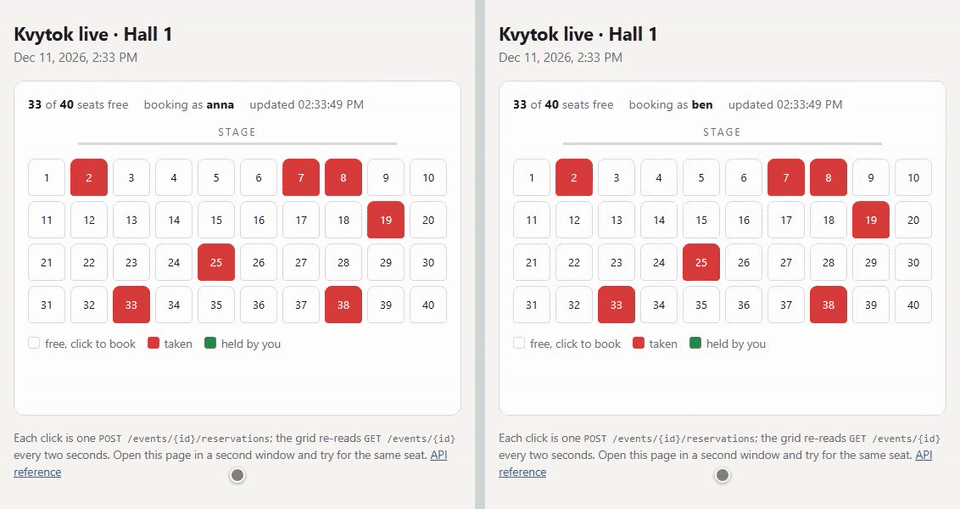
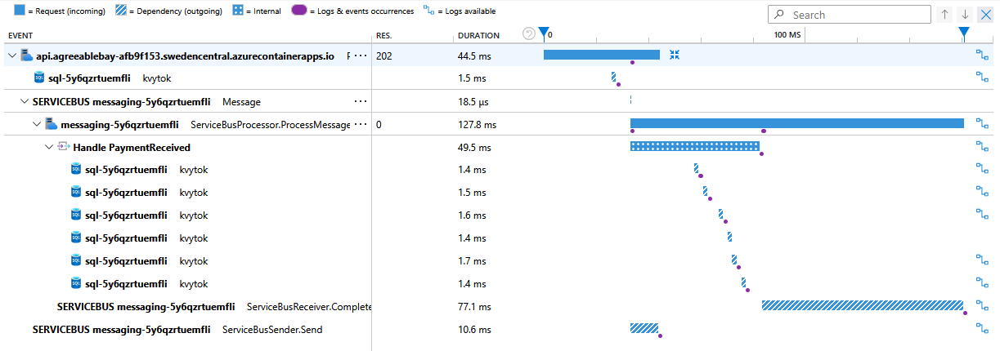
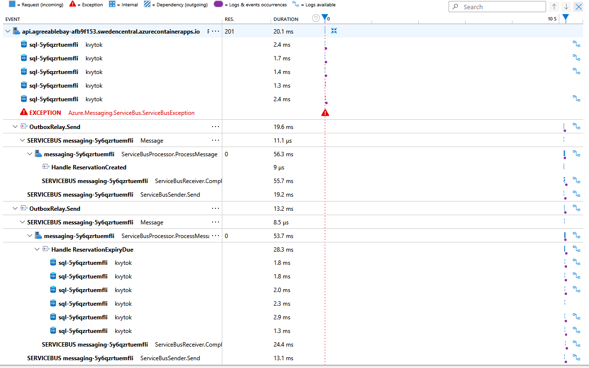

# Observability and the demo

Application Insights traces across the queue (including the outbox relay), the Azure dashboard,
and the two-window seat-grid demo.

## Two windows, one seat

Two windows on the [seat grid](../src/Kvytok.Api/wwwroot/demo/index.html) click seat 14 at the same
instant: two real `POST`s, sent together. The database decides. Here anna holds the seat and ben
gets the `409`; which window wins changes from run to run. Midway, a third client books seats 4
and 30, and both grids show them on their next two-second read. Then ben takes seat 15.
Recorded against a local Api by [scripts/demo-gif](../scripts/demo-gif/record.mjs), which creates
a fresh event and drives both windows through Playwright.

## One trace across the queue

A payment against the deployed environment, as Application Insights shows it:

The Api accepts the payment (`202`) and puts a message on the queue. The Worker's
`ProcessMessage` starts as the send ends, and its handling (`Handle PaymentReceived`, six
SQL calls) and the message's completion sit inside the same operation, 173 ms from the
request's first byte to the completion. In the raw telemetry the Worker's span has the
message's span (`Message`, one per message, beside `ServiceBusSender.Send`) as its parent,
and carries a link to it as well. The SDK's documentation describes the link; the parent
is what puts both apps in one trace rather than two that point at each other. Three
things make it so. The Azure SDK emits Service Bus spans only
behind `Azure.Experimental.EnableActivitySource`, set in both apps. The sender stamps each
message with its span (`Diagnostic-Id`). And `ServiceBusProcessor` continues from that
stamp, where a hand-written receive loop would only have linked to it.

The outbox would break the chain where it matters most. The in-process send runs inside
the request, so it inherits the trace. The relay runs on a timer, so a message it sends
late would start a trace of its own, cut off from the action that owed it. So the outbox
row stores the request's span as a W3C `traceparent`, written in the same transaction,
and the relay sends each row under an `OutboxRelay.Send` span parented to it. A message
that went out late stays in its request's trace and shows that it was relayed. An
integration test forces the immediate send to fail and checks that the relay's spans join
the request's trace. The picture above is the immediate path, which needs none of this;
the one below is a reservation whose immediate send was made to fail on purpose
(`Outbox:FailImmediatePublish`, see [Exercising the relay](deploy.md#exercising-the-relay)):

The request answers `201` and records the failure; both messages then go out under
`OutboxRelay.Send`, inside the same trace. The portal's waterfall draws the Worker's spans
at the wrong offsets, so the times are worth reading from the telemetry instead:

| After the request | What happened |
| --- | --- |
| 0.02 s | the immediate publish fails; both rows stay owed |
| 10.2 s | the relay sends both: the 5-second lease, then its next drain |
| 23.5 s | the Worker handles "reservation created", having started from zero |
| 30.07 s | the expiry is handled, on time for the 30-second hold despite the late send |

The last row is the one that matters. The expiry message carries the time it is due, and
the broker holds it until then. If the relay sent it late without that time, the broker
would deliver it at once and release the seat while the holder could still pay. The trace
shows the time surviving a late send once; an integration test checks it on every run,
asserting that a relayed expiry is still due at the reservation's `ExpiresAt`.

The expiry joins the reservation's trace on purpose: the reservation is what caused it.
Its trace therefore lasts as long as the hold (thirty seconds in the demo environment,
ten minutes by default). That is correct, but it reads like a slow request at first
glance; the alternative, a new trace that links back, would hide the cause one click
further away. That is why the first screenshot is a payment, which lasts milliseconds rather
than a hold and does not use the outbox: a payment the Api cannot publish is refused with
`503`, for the provider to retry.

The longest bar is not the work. Settling the message (`ServiceBusReceiver.Complete`, a
call to the broker) took 77 ms of `ProcessMessage`'s 128, against 50 ms for the handler
and its six SQL calls. The same call took 24 ms in an earlier trace, so it is broker
latency that varies from message to message, and on a fast handler it is most of the
time a message spends in the Worker.

Two things to know when reading these traces. The processor's
`ServiceBusReceiver.Receive` spans are not exported: each is a long poll that measures
time spent waiting for the queue, and shown beside a trace it stretches the timeline to
its own length. And both apps scale to zero, so the first message after
an idle period carries a gap while the Worker starts, plus a managed-identity token
fetch (`GetToken`) in each app. The payment's trace is from warm replicas; the relayed one
is not, which is its 23.5 s row.

## The dashboard

One Azure dashboard (`Kvytok` in the resource group) with three tiles, each a query on
Application Insights in one-minute bins:

- **Reservations per minute**, from a counter the Api adds to (`kvytok.reservations`): seats
  held, and requests that found the seat already taken, stacked. A burst for one seat shows
  as one hold on top of hundreds of `409`s.
- **Reserve seat latency**: p50, p95 and p99 of `POST /events/{eventId}/reservations`, measured
  in the Api, so without the network round trip that k6's numbers include.
- **Errors per minute**, by app: failed requests and failed message handling. Application
  Insights marks every `4xx` as failed, and a lost race is a `409`, so `4xx` is left out;
  counted, a contended seat would look like an outage.

The dashboard is Bicep ([dashboard.bicep](../src/Kvytok.AppHost/dashboard.bicep)), added by the
AppHost as a template, so it is provisioned with everything else and regenerated into `infra/`.
Each tile defaults to the last four hours.

